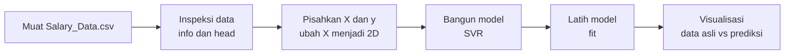

# Prediksi Gaji Berdasarkan Lama Pengalaman Kerja Menggunakan *Support Vector Regression* (SVR)


## Abstrak

Repositori ini memuat latihan penerapan *Support Vector Regression* (SVR) menggunakan pustaka *scikit-learn* untuk memodelkan hubungan antara lama pengalaman kerja (`YearsExperience`) dan gaji (`Salary`) pada dataset `Salary_Data.csv` yang terdiri atas 30 observasi. Tahapan meliputi pembacaan data, inspeksi struktur data, pemisahan atribut dan label, perubahan bentuk atribut menjadi larik dua dimensi, pelatihan model `SVR(C=1000, gamma=0.05, kernel='rbf')`, dan visualisasi hasil prediksi terhadap data asli. Hasil visualisasi menunjukkan bahwa kurva prediksi bersifat halus namun belum mengikuti kecenderungan data, terutama pada pengalaman kerja yang tinggi (indikasi *underfitting*). Dokumen ini menguraikan latar belakang, landasan teori, metodologi, cara menjalankan program, pembahasan hasil, keterbatasan, dan saran pengembangan.

**Kata kunci:** *support vector regression*, regresi, kernel RBF, prediksi gaji, *scikit-learn*.

---

## Daftar Isi

1. [Pendahuluan](#1-pendahuluan)
2. [Tinjauan Pustaka](#2-tinjauan-pustaka)
3. [Dataset](#3-dataset)
4. [Metodologi](#4-metodologi)
5. [Implementasi dan Cara Menjalankan](#5-implementasi-dan-cara-menjalankan)
6. [Hasil dan Pembahasan](#6-hasil-dan-pembahasan)
7. [Keterbatasan dan Saran Pengembangan](#7-keterbatasan-dan-saran-pengembangan)
8. [Kesimpulan](#8-kesimpulan)
9. [Referensi](#9-referensi)
10. [Penulis dan Lisensi](#10-penulis-dan-lisensi)

---

## 1. Pendahuluan

### 1.1 Latar Belakang

Regresi adalah teknik pemodelan untuk memprediksi nilai numerik kontinu dari satu atau lebih variabel prediktor. Salah satu metode yang banyak dipakai adalah *Support Vector Regression* (SVR), yaitu penerapan teori *Support Vector Machine* (SVM) pada permasalahan regresi (Drucker et al., 1997; Smola & Schölkopf, 2004). Dengan fungsi kernel, SVR mampu memodelkan hubungan non-linear.

Penelitian di Indonesia telah menerapkan SVR atau SVM untuk prediksi data numerik. Fuadi et al. (2021) memprediksi konsumsi listrik di laboratorium manajemen energi dan menentukan parameter $C$ serta $\gamma$ optimal. Adam et al. (2022) menggunakan SVR berkernel RBF untuk memprediksi keluaran daya fotovoltaik jangka pendek, sedangkan Suryani dan Fadhila (2024) memprediksi harga minyak mentah Indonesia (ICP) dengan SVR dan menyetel parameter $\epsilon$ dan $C$ menggunakan *grid search*. Ketiganya menunjukkan bahwa kinerja SVR sangat bergantung pada pemilihan parameter.

Repositori ini menerapkan SVR pada kasus sederhana satu fitur, yaitu hubungan pengalaman kerja dan gaji, sebagai latihan memahami alur dan peran parameter SVR.

### 1.2 Rumusan Masalah

1. Bagaimana membangun model SVR untuk memprediksi gaji berdasarkan lama pengalaman kerja menggunakan *scikit-learn*?
2. Seberapa baik kurva prediksi SVR berparameter $C=1000$, $\gamma=0{,}05$, dan kernel RBF mengikuti pola data asli?

### 1.3 Tujuan

1. Membangun dan melatih model SVR pada dataset `Salary_Data.csv`.
2. Memvisualisasikan dan menganalisis kesesuaian prediksi model terhadap data asli.

### 1.4 Manfaat

Repositori ini dapat dipakai sebagai bahan belajar alur dasar regresi dengan SVR, sekaligus contoh pengaruh pemilihan parameter terhadap bentuk kurva prediksi.

---

## 2. Tinjauan Pustaka

### 2.1 *Support Vector Regression* ($\epsilon$-SVR)

SVR mencari fungsi $f(x) = w \cdot \phi(x) + b$ yang menyimpang paling banyak sebesar $\epsilon$ dari target $y_i$ pada seluruh data latih, sambil menjaga fungsi sedatar mungkin. Penyimpangan di luar tabung $\epsilon$ dihukum melalui variabel *slack* $\xi_i$ dan $\xi_i^*$ (Smola & Schölkopf, 2004):

$$
\min_{w,b,\xi,\xi^*} \; \frac{1}{2}\lVert w \rVert^2 + C \sum_{i=1}^{n} (\xi_i + \xi_i^*)
$$

dengan syarat

$$
y_i - (w \cdot \phi(x_i) + b) \le \epsilon + \xi_i, \quad
(w \cdot \phi(x_i) + b) - y_i \le \epsilon + \xi_i^*, \quad
\xi_i, \xi_i^* \ge 0
$$

Parameter $C$ mengatur kompromi antara kerataan fungsi dan toleransi terhadap kesalahan di luar tabung $\epsilon$. Pada *scikit-learn*, nilai bawaan $\epsilon$ adalah 0,1 (Pedregosa et al., 2011).

### 2.2 Kernel *Radial Basis Function* (RBF)

$$
K(x, x') = \exp\left(-\gamma \lVert x - x' \rVert^2\right)
$$

Parameter $\gamma$ menentukan jangkauan pengaruh satu data latih: $\gamma$ kecil menghasilkan kurva yang lebih halus, sedangkan $\gamma$ besar menghasilkan kurva yang lebih mengikuti data latih. Kernel RBF juga menjadi kernel yang dipilih terbaik pada penelitian prediksi daya fotovoltaik oleh Adam et al. (2022).

### 2.3 Pentingnya Penyetelan Parameter

Fuadi et al. (2021) memperoleh parameter optimal $C = 10^6$ dan $\gamma = 2{,}97 \times 10^{-7}$ pada data konsumsi listrik, sedangkan Suryani dan Fadhila (2024) memperoleh kombinasi $C$ dan $\epsilon$ yang berbeda-beda untuk tiap variabel dan jenis minyak mentah. Hal ini menunjukkan bahwa nilai parameter yang baik bergantung pada skala dan karakteristik data, sehingga tidak ada satu nilai universal.

### 2.4 Skala Fitur

Metode berbasis kernel peka terhadap perbedaan skala. Standarisasi *Z-score*, $z = (x - \mu)/\sigma$, lazim digunakan untuk menyamakan skala fitur sebelum pelatihan (Pratama & Salam, 2025; Hsu et al., 2003).

### 2.5 Metrik Evaluasi Regresi

Beberapa metrik yang lazim digunakan: *Mean Absolute Error* (MAE), *Mean Squared Error* (MSE), *Root Mean Squared Error* (RMSE), dan koefisien determinasi $R^2$. Metrik seperti MAE, MSE, dan MAPE dipakai pada penelitian Fuadi et al. (2021) dan Adam et al. (2022). Notebook ini belum menghitung metrik tersebut (lihat Bab 7).

---

## 3. Dataset

Dataset `Salary_Data.csv` berisi hubungan antara lama pengalaman kerja dan gaji. Sumber dataset: `<isi tautan atau keterangan sumber dataset>`.

Berdasarkan keluaran `data.info()`, dataset terdiri atas **30 baris** dan **2 kolom**, tanpa nilai kosong (*non-null*), keduanya bertipe `float64`.

| No | Atribut | Tipe Data | Peran | Deskripsi |
|---|---|---|---|---|
| 1 | `YearsExperience` | float64 | Fitur ($X$) | Lama pengalaman kerja (tahun) |
| 2 | `Salary` | float64 | Target ($y$) | Gaji |

---

## 4. Metodologi

### 4.1 Alur Penelitian



### 4.2 Tahapan dan Kode

Setiap tahapan identik dengan sel pada notebook `Latihan_SKLearn_SVR.ipynb`.

**Tahap 1 — Pembacaan data.**

```python
import pandas as pd

# membaca dataset dan mengubahnya menjadi dataframe
data = pd.read_csv('Salary_Data.csv')
```

**Tahap 2 — Inspeksi data.**

```python
data.info()
data.head()
```

**Tahap 3 — Pemisahan atribut dan label.** `YearsExperience` menjadi fitur, `Salary` menjadi target. Karena *scikit-learn* mensyaratkan fitur berupa larik dua dimensi, `X` diubah bentuknya dari $(30,)$ menjadi $(30, 1)$ dengan `np.newaxis`.

```python
import numpy as np

# Memisahkan atribut dan label
X = data['YearsExperience']
y = data['Salary']

# Mengubah bentuk atribut menjadi array 2D
X = np.array(X)
X = X[:, np.newaxis]
```

**Tahap 4 — Pembangunan dan pelatihan model.** Model SVR dibuat dengan kernel RBF, $C = 1000$, dan $\gamma = 0{,}05$. Parameter lain (misalnya $\epsilon$) memakai nilai bawaan *scikit-learn*. Model dilatih menggunakan seluruh 30 data.

```python
from sklearn.svm import SVR

# Membangun model dengan parameter C, gamma, dan kernel
model = SVR(C=1000, gamma=0.05, kernel='rbf')

# Melatih model dengan fungsi fit
model.fit(X, y)
```

**Tahap 5 — Visualisasi.** Data asli ditampilkan sebagai titik biru dan hasil prediksi model sebagai garis merah.

```python
import matplotlib.pyplot as plt

# Memvisualisasikan model
plt.scatter(X, y, color='blue', label='Data Asli')
plt.plot(X, model.predict(X), color='red', label='Prediksi SVR')

plt.xlabel('Years Experience')
plt.ylabel('Salary')
plt.legend()
plt.show()
```

---

## 5. Implementasi dan Cara Menjalankan

### 5.1 Struktur Repositori

```text
.
├── Latihan_SKLearn_SVR.ipynb   # notebook utama
├── Salary_Data.csv             # dataset (letakkan di folder yang sama)
└── README.md
```

### 5.2 Prasyarat

- Python 3.x
- Pustaka: `pandas`, `numpy`, `scikit-learn`, `matplotlib`, dan `jupyter`

### 5.3 Langkah Menjalankan

1. **Klon repositori**

   ```bash
   git clone https://github.com/<username>/<nama-repositori>.git
   cd <nama-repositori>
   ```

2. **(Opsional) Buat *virtual environment***

   ```bash
   python -m venv venv
   source venv/bin/activate        # Windows: venv\Scripts\activate
   ```

3. **Pasang dependensi**

   ```bash
   pip install pandas numpy scikit-learn matplotlib jupyter
   ```

4. **Siapkan dataset.** Letakkan `Salary_Data.csv` satu folder dengan notebook, karena kode membaca berkas dengan jalur relatif.

5. **Jalankan notebook**

   ```bash
   jupyter notebook Latihan_SKLearn_SVR.ipynb
   ```

**Alternatif Google Colab:** unggah notebook dan `Salary_Data.csv` ke sesi Colab, lalu jalankan semua sel secara berurutan. Seluruh pustaka yang diperlukan sudah tersedia secara bawaan.

---

## 6. Hasil dan Pembahasan

### 6.1 Hasil Eksplorasi Data

Lima baris pertama data (`data.head()`):

| YearsExperience | Salary |
|---|---|
| 1.1 | 39343.0 |
| 1.3 | 46205.0 |
| 1.5 | 37731.0 |
| 2.0 | 43525.0 |
| 2.2 | 39891.0 |

Keluaran `data.info()` menunjukkan 30 entri (indeks 0–29) dengan dua kolom bertipe `float64` dan seluruhnya 30 *non-null*.

### 6.2 Hasil Pemodelan

Model yang dihasilkan adalah `SVR(C=1000, gamma=0.05)` (kernel RBF merupakan nilai bawaan sehingga tidak tampil pada representasi objek). Notebook menampilkan hasil dalam bentuk visualisasi berikut (data asli dan kurva prediksi):

<!-- Simpan gambar hasil plot ke folder images/ lalu aktifkan baris berikut -->
<!--  -->

Berdasarkan pembacaan visual atas plot:

| Pengamatan | Keterangan |
|---|---|
| Pola data asli | Gaji meningkat seiring bertambahnya pengalaman kerja, dengan kecenderungan yang mendekati linear |
| Bentuk kurva SVR | Halus dan landai: sekitar 61.000 pada pengalaman ±1 tahun, naik perlahan hingga sekitar 78.000 pada pengalaman ±10 tahun |
| Kesesuaian | Kurva cukup dekat dengan data pada rentang pengalaman sekitar 3–6 tahun, tetapi menjauh di kedua ujung: di atas data pada pengalaman rendah dan jauh di bawah data pada pengalaman tinggi (gaji aktual mendekati 120.000) |

### 6.3 Pembahasan

1. **Indikasi *underfitting*.** Kurva prediksi terlalu datar dibandingkan tren data sehingga galat sistematis terjadi pada pengalaman rendah dan tinggi. Dengan kata lain, model belum menangkap kemiringan hubungan antara pengalaman dan gaji.
2. **Dugaan penyebab.** Target `Salary` bernilai puluhan ribu hingga ratusan ribu dan tidak diskalakan, sedangkan $\epsilon$ memakai nilai bawaan 0,1 dan $C$ ditetapkan 1000. Pada skala target sebesar ini, penalti $C=1000$ kemungkinan terlalu kecil untuk memaksa kurva mendekati data, dan $\gamma = 0{,}05$ memberikan kurva yang sangat halus. Perlu ditekankan bahwa ini merupakan **hipotesis** yang perlu diuji melalui eksperimen, bukan kesimpulan yang dibuktikan oleh notebook. Sebagai pembanding, Fuadi et al. (2021) memperoleh nilai $C$ optimal sebesar $10^6$ pada datanya, sehingga nilai $C$ yang besar tidak janggal untuk SVR.
3. **Parameter ditetapkan manual.** Berbeda dengan Fuadi et al. (2021) dan Suryani dan Fadhila (2024) yang mencari parameter terbaik secara sistematis, notebook ini memakai satu kombinasi parameter tanpa pencarian.
4. **Evaluasi hanya visual.** Tidak ada metrik numerik (MAE, RMSE, $R^2$) dan tidak ada pembagian data latih-uji, sehingga kualitas model tidak dapat dibandingkan secara kuantitatif.

---

## 7. Keterbatasan dan Saran Pengembangan

### 7.1 Keterbatasan Implementasi Saat Ini

1. **Tidak ada pembagian data latih dan uji.** Model dilatih dan divisualisasikan pada 30 data yang sama (*in-sample*), sehingga kemampuan generalisasi pada data baru belum terukur.
2. **Tidak ada metrik numerik.** Evaluasi hanya berupa inspeksi visual.
3. **Parameter tidak disetel.** Nilai $C$, $\gamma$, $\epsilon$, dan jenis kernel dipilih manual tanpa validasi.
4. **Data dan target tidak diskalakan.** Skala `Salary` jauh lebih besar daripada `YearsExperience`.
5. **Ukuran sampel kecil.** Hanya 30 observasi dan satu fitur, sehingga hasil tidak dapat digeneralisasi ke kasus pengupahan secara umum.
6. **Garis prediksi digambar dengan `plt.plot(X, ...)` secara berurutan.** Hasilnya rapi hanya bila data terurut menurut `YearsExperience`, sebagaimana kondisi data pada plot ini. Bila data tidak terurut, `X` perlu diurutkan terlebih dahulu.

### 7.2 Saran Pengembangan

- Membagi data menjadi data latih dan uji (`train_test_split`) atau memakai validasi silang (`KFold`).
- Menghitung MAE, RMSE, dan $R^2$ (`sklearn.metrics`).
- Mencari parameter terbaik ($C$, $\gamma$, $\epsilon$, kernel) dengan `GridSearchCV`, mencakup rentang $C$ yang jauh lebih besar (Fuadi et al., 2021; Suryani & Fadhila, 2024).
- Menstandarisasi fitur dan target (misalnya `StandardScaler`) lalu mengembalikan prediksi ke skala asli dengan `inverse_transform` (Pratama & Salam, 2025; Hsu et al., 2003).
- Mencoba kernel `linear`, mengingat pola data mendekati linear, serta membandingkannya dengan `LinearRegression` sebagai model pembanding.
- Menggunakan `Pipeline` agar pra-pemrosesan hanya mempelajari data latih.

---

## 8. Kesimpulan

Penelitian ini membangun model SVR berkernel RBF dengan $C = 1000$ dan $\gamma = 0{,}05$ untuk memodelkan hubungan pengalaman kerja dan gaji pada 30 data. Hasil visualisasi menunjukkan bahwa model menangkap kenaikan gaji secara umum, tetapi kurvanya terlalu landai dan tidak mengikuti data pada pengalaman rendah maupun tinggi (*underfitting*). Karena itu, konfigurasi ini belum memadai sebagai model prediksi. Perbaikan yang disarankan meliputi penyetelan parameter, penskalaan data, pembagian data latih-uji, dan evaluasi dengan metrik numerik.

---

## 9. Referensi

### 9.1 Jurnal Nasional Terakreditasi SINTA

| No | Referensi | Akreditasi |
|---|---|---|
| 1 | Fuadi, A. Z., Haq, I. N., & Leksono, E. (2021). Support vector machine to predict electricity consumption in the Energy Management Laboratory. *Jurnal RESTI (Rekayasa Sistem dan Teknologi Informasi), 5*(3), 466–473. https://doi.org/10.29207/resti.v5i3.2947 | SINTA 2 |
| 2 | Adam, K. B., Silalahi, D. K., Aprillia, B. S., & Adhari, H. A. (2022). Support vector regression method for predicting off-grid photovoltaic output power in the short term. *Jurnal RESTI (Rekayasa Sistem dan Teknologi Informasi), 6*(4). http://jurnal.iaii.or.id/index.php/RESTI/article/view/4134 | SINTA 2 |
| 3 | Suryani, D., & Fadhila, M. (2024). Indonesian crude oil price (ICP) prediction using support vector regression algorithm. *Jurnal RESTI (Rekayasa Sistem dan Teknologi Informasi), 8*(1). https://doi.org/10.29207/resti.v8i1.5551 | SINTA 2 |
| 4 | Pratama, Y. D., & Salam, A. (2025). Comparison of data normalization techniques on KNN classification performance for Pima Indians Diabetes dataset. *Journal of Applied Informatics and Computing, 9*(3), 693–706. https://doi.org/10.30871/jaic.v9i3.9353 | SINTA 3 |

> Status akreditasi mengacu pada informasi resmi pengelola jurnal (RESTI: SK Dirjen No. 158/E/KPT/2021, Peringkat 2; JAIC: SK Dirjen No. 79/E/KPT/2023, SINTA 3). Periksa status terkini pada [SINTA](https://sinta.kemdiktisaintek.go.id) sebelum penggunaan formal.

### 9.2 Referensi Internasional dan Dokumentasi

5. Drucker, H., Burges, C. J. C., Kaufman, L., Smola, A., & Vapnik, V. (1997). Support vector regression machines. *Advances in Neural Information Processing Systems, 9*, 155–161.
6. Harris, C. R., Millman, K. J., van der Walt, S. J., Gommers, R., Virtanen, P., Cournapeau, D., … Oliphant, T. E. (2020). Array programming with NumPy. *Nature, 585*, 357–362. https://doi.org/10.1038/s41586-020-2649-2
7. Hsu, C.-W., Chang, C.-C., & Lin, C.-J. (2003). *A practical guide to support vector classification*. Department of Computer Science, National Taiwan University.
8. Hunter, J. D. (2007). Matplotlib: A 2D graphics environment. *Computing in Science & Engineering, 9*(3), 90–95. https://doi.org/10.1109/MCSE.2007.55
9. Pedregosa, F., Varoquaux, G., Gramfort, A., Michel, V., Thirion, B., Grisel, O., … Duchesnay, É. (2011). Scikit-learn: Machine learning in Python. *Journal of Machine Learning Research, 12*, 2825–2830.
10. Smola, A. J., & Schölkopf, B. (2004). A tutorial on support vector regression. *Statistics and Computing, 14*(3), 199–222. https://doi.org/10.1023/B:STCO.0000035301.49549.88

---

## 10. Penulis dan Lisensi

**Penulis:** `<Nama Anda>` — `<Institusi / Program Studi>`  
**Kontak:** `<email atau tautan profil>`

Proyek ini dirilis di bawah lisensi `<MIT / Apache-2.0 / lainnya>`. Dataset tunduk pada ketentuan lisensi penyedia aslinya.

Jika repositori ini bermanfaat, silakan beri ⭐ dan sitasi sebagaimana mestinya.
